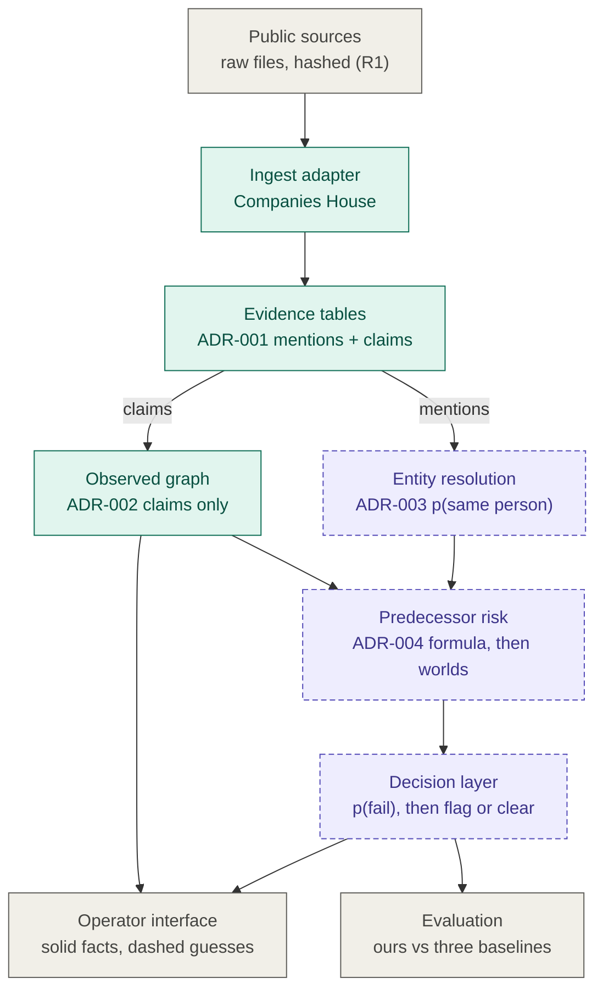

# Pipeline

Up: [[Project]]

How a company number becomes a credit decision, without mixing up what we know with what we guess. Teal boxes with solid borders carry what sources state. Purple boxes with dashed borders carry what we infer, always with a probability.

## How it works
1. **Sources and ingest.** The adapter downloads the raw records into `data/raw/`, leaves them untouched and keeps each one's hash (R1).
2. **Evidence tables.** The adapter writes **mentions** (each company or person as one record names them, spelled as written) and **claims** (each relationship a record states, with its dates). Every row keeps its source (R2). ADR-001.
3. **Two paths.** Claims are filtered into the observed graph, which holds facts only (R3, ADR-002). Mentions go to entity resolution, which gives each pair of people a probability of being the same person and never merges them (R6, ADR-003).
4. **Predecessor risk.** This is the chance that at least one of the company's directors ran an earlier company that went insolvent: 1 − ∏(1 − pᵢ) over every candidate match. The formula is exact when the matches are independent. On Sunday, the one-identity rule (one director is only one person) replaces it, and we measure whether the flags improve (ADR-004).
5. **Decision.** A straight line fitted on the 2021 companies turns that chance into the chance the company fails. The user's three costs (a missed case, a wrong flag, asking) then give FLAG, CLEAR or NOT ENOUGH EVIDENCE (R8).
6. **Interface and evaluation.** The interface draws facts solid and guesses dashed, with the evidence one click away and names masked. Evaluation compares us on the same data with three baselines: flag nothing, same name means same person, and Companies House's own officer links. It trains on 2021 companies and tests on 2022 ones.

**In our case:** the query is a company number. Mentions are companies, directors and owners as Companies House records them. Claims are "is a director of" and "controls", with their dates. The hidden relationship we look for is a predecessor: an earlier company, run by the same people, that went insolvent.

The boxes we build, their files and who leads each: [[Modules]]
