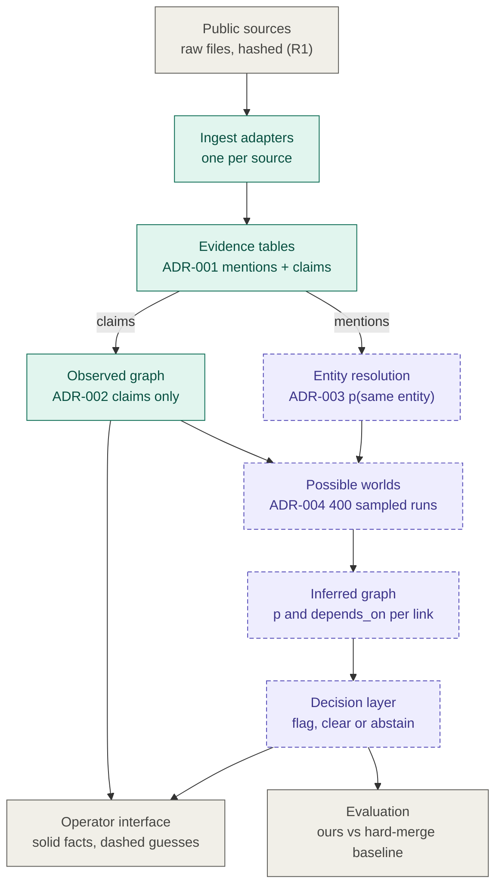

# Pipeline

Up: [[Project]]

How a company number becomes a credit decision, without mixing up what we know with what we guess. Teal boxes with solid borders carry what sources state. Purple boxes with dashed borders carry what we infer, always with a probability.

## How it works
1. **Sources and ingest.** One adapter per source downloads the raw records, keeps them untouched in `data/raw/` and hashes them (R1).
2. **Evidence tables.** The adapter writes **mentions** (each company or person as one record names them, spelled as written) and **claims** (each relationship a record states, with its dates). Every row keeps its source (R2). ADR-001.
3. **Two paths.** Claims go straight into the observed graph, which holds facts only (R3, ADR-002). Mentions go to entity resolution, which gives each pair a probability of being the same entity and never merges them (R6, ADR-003).
4. **Possible worlds.** We draw 400 versions of who is who from those probabilities, rerun the reasoning in each and average. Every inferred link ends up with a probability and a list of what it depends on (R4, R7, ADR-004).
5. **Decision.** The user's three costs (a wrong flag, a missed case, asking) turn the probability into FLAG, CLEAR or NOT ENOUGH EVIDENCE (R8).
6. **Interface and evaluation.** The interface draws facts solid and guesses dashed, with the evidence one click away. Evaluation runs the same pipeline with the hard-merge baseline swapped in at entity resolution (ADR-005), trained on earlier companies and tested on later ones.

**In our case:** the query is a company number. Mentions are companies, directors and owners as Companies House records them. Claims are "is a director of" and "controls", with their dates. The hidden relationship we look for is a predecessor: an earlier company, run by the same people, that went insolvent.

The boxes we build, their files and who leads each: [[Modules]]
