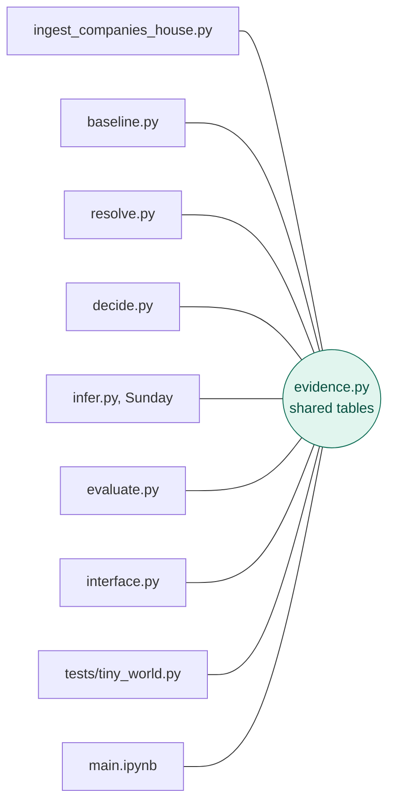

# Plan

Up: [[Project]]

How we split the work: **no fixed roles.** Everyone claims their own cards on the board, one at a time, in the order below. The boxes only meet through the shared tables in `src/evidence.py`, so nobody ends up tangled in someone else's code. Decided Sat 08:10 (see the decision "No fixed roles, everyone claims their own cards").

## The choices
1. **Lighter MVP.** P(insolvent predecessor) by the formula, P(fail) by a straight line, then the cost-based decision. One identity per director is Sunday's measured improvement (#32).
2. **Slice.** Construction companies (SIC 41–43) formed in 2021 (train and validation) and 2022 (test), about 3,000 per year. We widen it if #19 counts too few positives.
3. **Label.** Liquidation or administration within 24 months of incorporation.
4. **Costs.** A missed case 10, a wrong flag 2, asking 1. So FLAG above P(fail) 0.5, CLEAR below 0.1, and NOT ENOUGH EVIDENCE in between.

## How to pick your next card
1. Finish or hand back your current card. One card In Progress per person.
2. Take the highest card in the order below that is free and not waiting on an unfinished card.
3. Claim it before you start: assign yourself and drag it to In Progress.
4. While you hold a box's card, that box's file is yours. Need a change in a file someone else holds? Ask on the call.
5. At every check-in, look at who holds what. If one person carries most of the P0 work, rebalance.

## The order
**Start here, in parallel, 08:45–09:30. Everything else waits on these three.**
- #20 Repo skeleton
- #22 Schema v1 and the observed graph
- #19 Data check and slice

**L0, by 13:00**
- #24 Crawl, running in the background (needs #19)
- #21 Tiny world (needs #22)
- #23 Rule tests (needs #21 and #22; best taken by someone who didn't build the schema)
- #25 Adapter to mentions and claims, with #49 masking (needs #22 and #24)
- #28 Label and time split
- #27 The three baselines
- #30 Blocking and features
- #29 Notebook end to end on the tiny world

**L1, by 19:00**
- #31 Matcher and calibration (needs #30)
- #33 Line to P(fail) (needs #28), then #34 decision layer
- #35 Interface v1
- #36 Notebook on real data
- #39 False flags by name commonness and #40 five failures

**L2, Saturday evening to Sunday 12:00**
- #37 What would flip each decision and #38 what-if toggles and cost sliders
- #32 One identity per director, the measured improvement
- #42 Static figures

**Sunday, after the 14:00 freeze**
- #45 Test set, run once
- #46 Write-up, #47 video, #50 Credits and README
- #48 Fresh-run test, by someone who didn't write the notebook
- #51 First submission at 18:00, #52 final by 20:30

## One schema in the middle

## Rules that stop the spider web
- **Boxes import only `evidence.py`.** Nobody imports anyone else's file, and only `main.ipynb` calls the boxes, in order.
- **Six shared tables,** defined once in `evidence.py`: mentions, claims, labels, pairs, links and decisions. Every box runs the schema's check on its output before anyone reads it. The columns are listed in Modules.
- **The schema has one steward at a time,** whoever holds its card (#22). A change happens on a call, bumps the schema version and updates Modules in the same push.
- **Build on the tiny world first.** Every box runs on the hand-made example, so nobody waits for real data or for another box.
- **Tests come from someone else.** Whoever builds the schema doesn't write the rule tests.
- **Your card, your file.** While you hold a box's card, nobody else edits that file.

## Gates
| When (CET) | Gate | Our target |
|---|---|---|
| Sat 09:30 | Skeleton, schema v1 and the data check | Everyone unblocked |
| Sat 14:00 | Skeleton check-in | 13:00: tiny world end to end, three baseline numbers |
| Sat 21:00 | MVP gate | 19:00: real slice end to end, decisions, interface v1 |
| Sun 14:00 | Feature freeze | 12:00: one identity measured, figures, what-if |
| Sun 18:00 | First submission | Fresh-run test passed by 17:30 |
| Sun 21:00 | Final submission | 20:30 |

When something slips, cut from the top layer in Modules, never the deadline.
