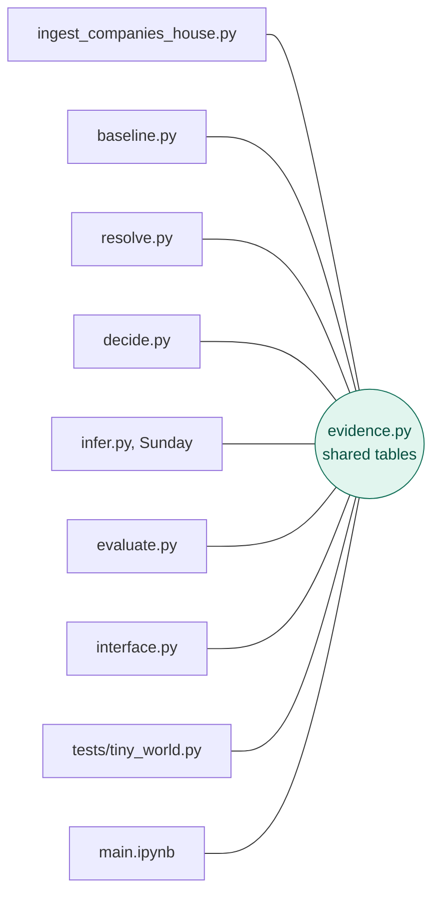

# Plan

Up: [[Project]]

The choices we build on and the rules that keep the boxes apart. **No fixed roles:** everyone claims their own work (see the decision "No fixed roles, everyone claims their own cards"). What to claim and in which order lives on the board: areas, cards and sub-tasks, with one milestone per gate (Task Protocol). The timetable is in Next 24 hours.

## The choices
1. **Lighter MVP.** P(insolvent predecessor) by the formula, P(fail) by a straight line, then the cost-based decision. One identity per director is Sunday's measured improvement (#32).
2. **Slice.** Construction companies (SIC 41–43) formed in 2021 (train and validation) and 2022 (test), about 3,000 per year. We widen it if #19 counts too few positives.
3. **Label.** Liquidation or administration within 24 months of incorporation.
4. **Costs.** A missed case 10, a wrong flag 2, asking 1. So FLAG above P(fail) 0.5, CLEAR below 0.1, and NOT ENOUGH EVIDENCE in between.

## One schema in the middle

## Rules that stop the spider web
- **Boxes import only `evidence.py`.** Nobody imports anyone else's file, and only `main.ipynb` calls the boxes, in order.
- **Six shared tables,** defined once in `evidence.py`: mentions, claims, labels, pairs, links and decisions. Every box runs the schema's check on its output before anyone reads it. The columns are listed in Modules.
- **One person per file at a time.** Sub-tasks of one card often share a file: 22.1 to 22.4 all live in `evidence.py`, and 34.1 to 34.3 in `decide.py`. Whoever claims the first of them takes the rest that touch the same file, or waits until that file's sub-task is merged. Two people never edit one file in parallel.
- **The schema has one steward at a time,** whoever holds the schema sub-tasks (22.x). A change happens on a call, bumps the schema version and updates Modules in the same push.
- **Build on the tiny world first.** Every box runs on the hand-made example, so nobody waits for real data or for another box.
- **Tests come from someone else.** Whoever builds the schema doesn't write the rule tests.

## Gates
The milestones on the board: 1 · Scope lock (Sat 10:00), 2 · L0 tiny world (target 13:00, check-in 14:00), 3 · L1 real slice (target 19:00, MVP gate 21:00), 4 · L2 improvement (Sun 12:00, freeze 14:00), 5 · First submission (Sun 18:00), 6 · Final submission (Sun 21:00, aim for 20:30).

When something slips, cut from the top layer in Modules, never the deadline.
