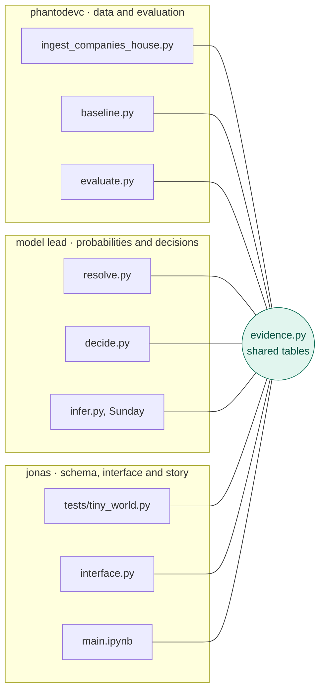

# Plan

Up: [[Project]]

Who builds what, and when. Each person owns their own boxes, and boxes only meet through the shared tables in `src/evidence.py`. Chosen by jonas as coordinator on Sat 08:00; the call can still change it (task #3).

## The five choices
1. **Lighter MVP.** P(insolvent predecessor) by the formula, P(fail) by a straight line, then the cost-based decision. One identity per director is Sunday's measured improvement (#32).
2. **Slice.** Construction companies (SIC 41–43) formed in 2021 (train and validation) and 2022 (test), about 3,000 per year. We widen it if #19 counts too few positives.
3. **Label.** Liquidation or administration within 24 months of incorporation.
4. **Costs.** A missed case 10, a wrong flag 2, asking 1. So FLAG above P(fail) 0.5, CLEAR below 0.1, and NOT ENOUGH EVIDENCE in between.
5. **Roles.** phantodevc is the data and evaluation lead. The model lead owns probabilities and decisions. jonas is the product and story lead and the coordinator, and owns the schema.

## Three lanes, one schema

Every box talks only to the shared tables. Only `main.ipynb` calls the boxes, in order.

## Who builds what

### phantodevc · data and evaluation
Owns `src/ingest_companies_house.py`, `src/baseline.py` and `src/evaluate.py`. Writes the mentions, claims and labels tables, the baselines' pairs and decisions, and every metric.
1. #19 Data check and slice, by 09:30
2. #24 Crawl running in the background, by 10:00
3. #25 Adapter to mentions and claims, with masked display columns (#49)
4. #28 Label and time split
5. #27 The three baselines, with first numbers by 13:00
6. #39 False flags by name commonness and #40 five failures, by 21:00
7. Sunday: #42 figures, #45 test set once (after 14:00), #50 Credits and README, #48 fresh-run test at 17:00

### Model lead · probabilities and decisions
Owns `src/resolve.py`, `src/decide.py`, `src/infer.py` and `tests/test_rules.py`. Writes the pairs, links and decisions tables.
1. #20 Repo skeleton, by 09:00. Everything else lands on it
2. #23 Rule tests on the tiny world
3. #30 Blocking and features, then #31 matcher and calibration
4. #33 The straight line to P(fail) and #34 the decision layer, by 19:00
5. #37 What would flip each decision, Saturday evening
6. Sunday: #32 one identity per director, the measured improvement, by 12:00

### jonas · schema, interface and story, coordinator
Owns `src/evidence.py`, `tests/tiny_world.py`, `src/interface.py` and `notebooks/main.ipynb`. Writes the schema everyone else writes into, and the observed graph.
1. #22 Schema v1, by 09:30. Everyone builds against it
2. #21 Tiny world and #29 notebook end to end on it, by 13:00
3. #35 Interface v1 and #36 notebook on real data, by 19:00
4. #38 What-if toggles and cost sliders, Saturday evening
5. Sunday: polish, #46 write-up, #47 video, #51 first submission at 18:00, #52 final by 20:30

## Rules that stop the spider web
- **Boxes import only `evidence.py`.** Nobody imports anyone else's file, and only `main.ipynb` calls the boxes, in order.
- **Six shared tables,** defined once in `evidence.py`: mentions, claims, labels, pairs, links and decisions. Every box runs the schema's check on its output before anyone reads it. The columns are listed in Modules.
- **The schema has one owner,** jonas. A change happens on a call, bumps the schema version and updates Modules in the same push.
- **Build on the tiny world first.** Every box runs on the hand-made example, so nobody waits for real data or for another box.
- **Tests come from someone else.** The model lead writes the rule tests, so the schema and the decisions get a second pair of eyes.
- **Your files, your cards.** Need a change in someone else's box? Ask on the call; don't edit it.

## Gates
| When (CET) | Gate | Our target |
|---|---|---|
| Sat 09:30 | Schema v1 and the data check | Everyone unblocked |
| Sat 14:00 | Skeleton check-in | 13:00: tiny world end to end, three baseline numbers |
| Sat 21:00 | MVP gate | 19:00: real slice end to end, decisions, interface v1 |
| Sun 14:00 | Feature freeze | 12:00: one identity measured, figures, what-if |
| Sun 18:00 | First submission | Fresh-run test passed by 17:30 |
| Sun 21:00 | Final submission | 20:30 |

When something slips, cut from the top layer in Modules, never the deadline.
